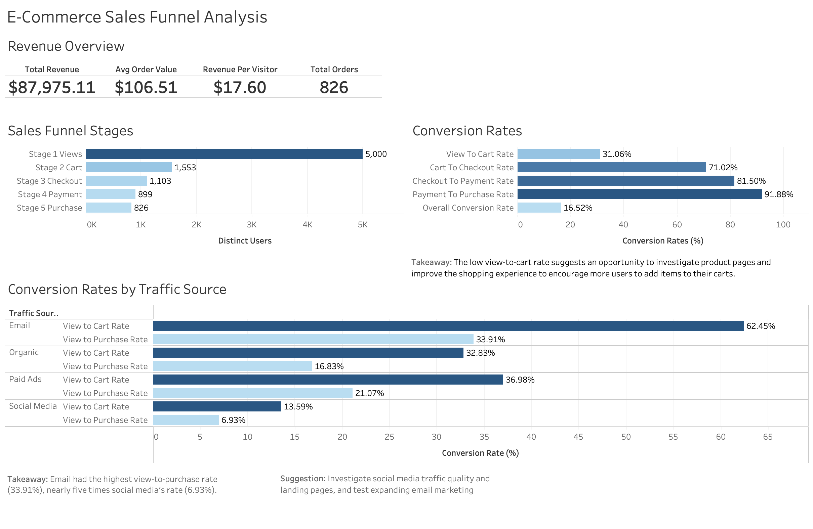

# E-commerce Sales Funnel Analysis

**Otto Ganser | MySQL · Tableau Public**

Analyzed e-commerce user events to compare funnel participation, traffic-source conversion rates, and revenue. Built a Tableau dashboard to communicate findings and identify areas for further investigation.

[View the Tableau Dashboard](https://public.tableau.com/views/E-CommerceSalesFunnelAnalysis_17930521046890/E-CommerceSalesFunnelAnalysis)

## Project Overview

The dashboard includes:

- Revenue and order metrics
- User counts across five purchasing stages
- Overall stage ratios
- View-to-cart and view-to-purchase rates by traffic source

## Business Questions

1. Where is the largest decrease in user counts across purchasing stages?
2. Which traffic sources have the highest and lowest conversion rates?
3. How much revenue did purchases generate, and what was the average order value?

## Key Findings

- **Largest decrease in stage counts:** 5,000 users recorded page views, compared with 1,553 who added items to their carts.
- **Email had the highest conversion rates:** 62.45% for view to cart and 33.91% for view to purchase.
- **Social media had the lowest conversion rates:** 13.59% for view to cart and 6.93% for view to purchase. Email's view-to-purchase rate was approximately 4.9 times social media's.
- **Purchase events generated $87,975.11 in revenue** across 826 orders, with an average order value of $106.51.

## Revenue Overview

| Metric | Value |
|---|---:|
| Total revenue | $87,975.11 |
| Total orders | 826 |
| Average order value | $106.51 |
| Revenue per page-view user | $17.60 |

## Funnel Participation

| Stage | Distinct Users |
|---|---:|
| Page view | 5,000 |
| Add to cart | 1,553 |
| Checkout start | 1,103 |
| Payment information | 899 |
| Purchase | 826 |

Overall stage ratios use independently counted user totals:

- **Purchase-to-view ratio:** 16.52%
- **View-to-cart ratio:** 31.06%

## Traffic-Source Results

| Traffic Source | Page View Users | Purchasers at or After View | View-to-Cart Rate | View-to-Purchase Rate |
|---|---:|---:|---:|---:|
| Email | 522 | 177 | 62.45% | 33.91% |
| Paid Ads | 968 | 204 | 36.98% | 21.07% |
| Organic | 2,038 | 343 | 32.83% | 16.83% |
| Social Media | 1,472 | 102 | 13.59% | 6.93% |

**Organic had the largest purchaser count, while email had the highest view-to-purchase rate.**

## Recommendations

- Investigate product pages and the shopping experience to identify potential improvements to cart engagement.
- Examine social traffic quality and landing pages to understand the lower conversion rates.
- Test expanding email marketing and measure whether conversion performance holds for a broader audience.
- Collect channel costs and revenue by source before recommending changes to marketing budgets.

## Technical Approach

### MySQL

- Used common table expressions (CTEs) and conditional aggregation to calculate distinct-user stage counts.
- Joined users' first page views by source to subsequent cart and purchase events.
- Used `NULLIF` to protect division calculations and `ROUND` for two-decimal reporting.
- Calculated revenue, average order value, revenue per buyer, and revenue per visitor.
- Retained a time-to-conversion query as additional analysis outside the current dashboard.

### Tableau Public

- Imported SQL result summaries through CSV files.
- Built bar charts for stage counts and conversion comparisons.
- Created a revenue summary.
- Added findings and recommendations to the dashboard.

## Metric Definitions and Scope

| Metric | Definition |
|---|---|
| Overall stage ratios | Distinct users at one stage divided by distinct users at the preceding stage |
| Overall purchase-to-view ratio | Distinct purchasers divided by distinct page-view users |
| Source view-to-cart rate | Percentage of page-view users from a source with a cart event at or after their first view from that source |
| Source view-to-purchase rate | Percentage of page-view users from a source with a purchase event at or after their first view from that source |
| Total revenue | Sum of purchase-event amounts |
| Average order value | Total revenue divided by purchase-event count |
| Revenue per visitor | Total revenue divided by distinct page-view users |

### Methodology Notes

- **Independent stage counts:** Overall stage ratios do not verify that the same users completed all stages in order.
- **Source attribution:** Later events can have any traffic source. Users who viewed through multiple sources may count as converters for each source.
- **Conversion window:** No fixed conversion window is applied. A purchase does not require a preceding cart event.
- **Order assumption:** Each purchase event is assumed to represent one order.
- **Timing analysis:** Uses the earliest timestamp for each event independently. Missing events and event ordering require review before interpreting averages.
- **Percentage scale:** Rates are exported on a 0–100 scale; `33.91` represents `33.91%`.
- **Static summaries:** CSV exports do not support shared filters that recalculate all metrics.
- **Interpretation:** Channel comparisons are observational and do not establish causation or profitability.

## Repository Files

Update these filenames to match the files uploaded to the repository.

| File | Description |
|---|---|
| `funnel_analysis.sql` | SQL queries for funnel stages, rates, source conversion, revenue, and conversion timing |
| `dashboard.png` | Dashboard preview |
| `sales_funnel.twbx` | Packaged Tableau workbook |
| `data/` | Source data and exported summaries, where sharing is permitted |

## Reproduce the Analysis

1. Obtain the dataset. **Add the dataset source and download link here.**
2. Create a MySQL database named `users` and import the dataset into `user_events`.
3. Confirm the required columns:
   - `user_id`
   - `event_type`
   - `event_date`
   - `traffic_source`
   - `amount`
4. Run `funnel_analysis.sql` and export the result sets to CSV.
5. Open the Tableau workbook and reconnect its data sources to the exported files as needed.
6. Refresh the worksheets and check that their values match the SQL output.

## Future Improvements

- Validate a complete sequential purchasing funnel.
- Add a defined conversion window and explicit attribution model.
- Use event-level data to support date and traffic-source filters.
- Analyze acquisition cost, revenue by source, and marketing return.

## Author

**Otto Ganser**

[LinkedIn](https://www.linkedin.com/in/otto-ganser/)
