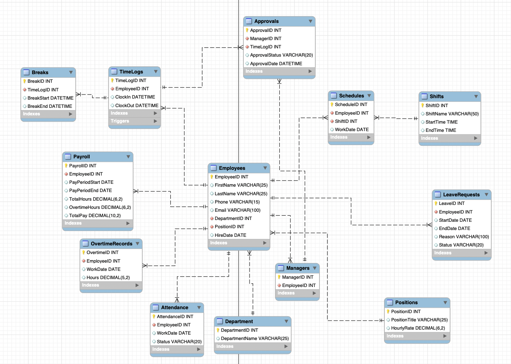

# Restaurant Workforce Database

A MySQL database for restaurant employee scheduling, time tracking, and workforce reporting. Built as a team project for INET 4707 at the University of Minnesota.

# Database Schema


## What the database does

- Models employees, departments, positions, schedules, time logs, breaks, approvals, leave requests, attendance, overtime, and payroll across 13 related tables.
- Uses triggers to validate completed time logs, record attendance and overtime, and add hours to matching payroll periods.
- Provides reporting views for hours worked, overtime, attendance rates, and weekly payroll costs.
- Uses the `GetEmployeeSchedule` stored procedure to retrieve an employee's scheduled shifts.

## Setup

Run the script once on a MySQL instance where the `Restaurant` database does not already exist. The script creates the database and loads fictional sample records. The account needs permission to create the database and its objects.

```bash
mysql -u YOUR_USERNAME -p < restaurant_database.sql
```

## Demo

Open a MySQL session after setup. This demo schedules a shift, adds a second payroll period, and records an 8.5-hour shift. The transaction rolls back the demo changes so you can run it again.

```sql
USE Restaurant;
START TRANSACTION;

INSERT INTO Schedules (EmployeeID, ShiftID, WorkDate)
VALUES (6, 1, '2026-04-15');

CALL GetEmployeeSchedule(6);

INSERT INTO Payroll
    (EmployeeID, PayPeriodStart, PayPeriodEnd, TotalHours, OvertimeHours, TotalPay)
VALUES
    (6, '2026-04-18', '2026-04-24', 0, 0, 0);

INSERT INTO TimeLogs (EmployeeID, ClockIn, ClockOut)
VALUES (6, '2026-04-15 08:00:00', '2026-04-15 16:30:00');

SELECT Status
FROM Attendance
WHERE EmployeeID = 6 AND WorkDate = '2026-04-15';

SELECT Hours
FROM OvertimeRecords
WHERE EmployeeID = 6 AND WorkDate = '2026-04-15';

SELECT PayPeriodStart, PayPeriodEnd, TotalHours
FROM Payroll
WHERE EmployeeID = 6
ORDER BY PayPeriodStart;

ROLLBACK;
```

Expected results include the April 15 schedule entry, `Present` attendance, and `0.50` overtime hours.

| Pay period | Hours before | Hours after |
| --- | ---: | ---: |
| April 10–17, 2026 | 30.00 | 38.50 |
| April 18–24, 2026 | 0.00 | 0.00 |

To check validation separately, try inserting a log with a clock-out before the clock-in. MySQL should reject it with SQLSTATE `45000`.

```sql
INSERT INTO TimeLogs (EmployeeID, ClockIn, ClockOut)
VALUES (6, '2026-04-15 08:00:00', '2026-04-15 07:00:00');
```

## Scope

The demo uses an eight-hour overtime threshold per time log. Payroll hours use the clock-in date and inclusive pay period boundaries, so periods for the same employee should not overlap. The payroll trigger updates total hours on insert. Payroll dollar amounts and payroll overtime totals are seeded sample values. Break deductions, approval-based pay, and recalculation after edits are outside the demo workflow.
