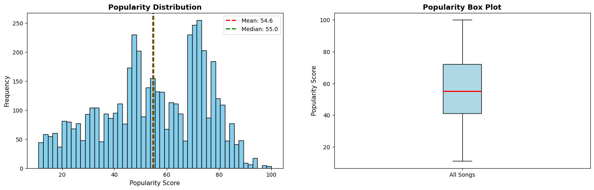
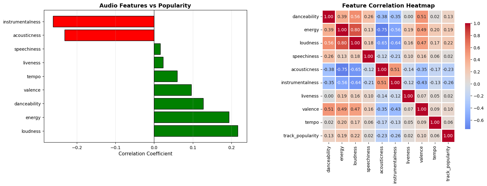
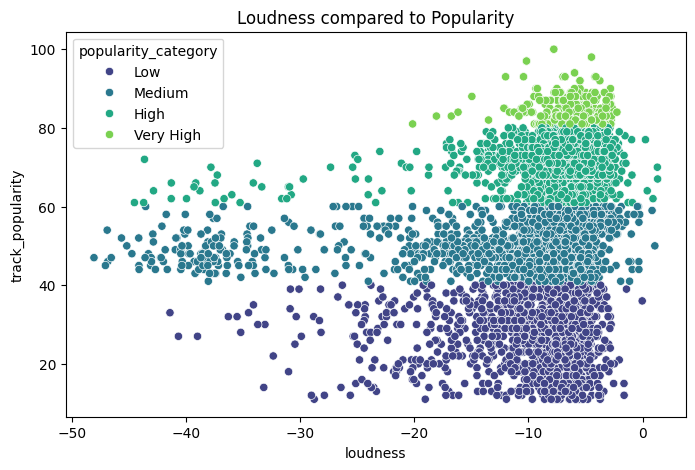
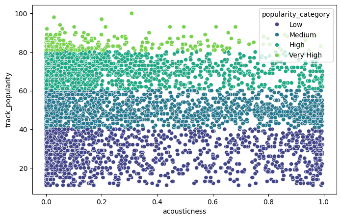
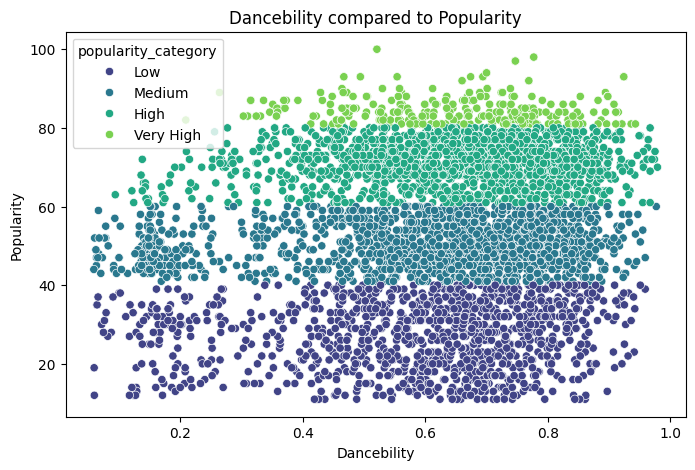
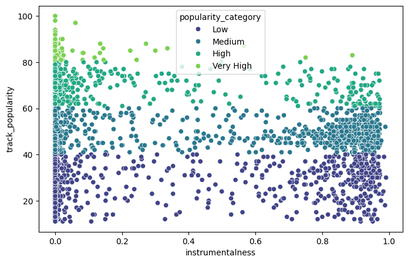
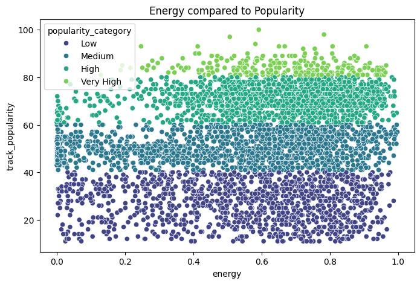
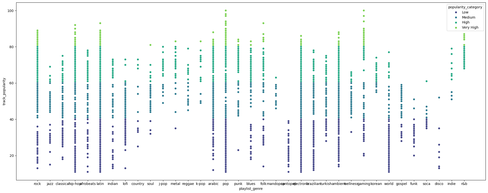
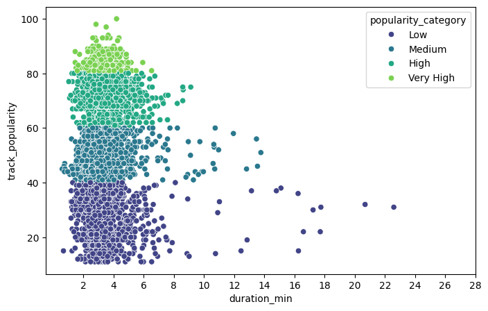
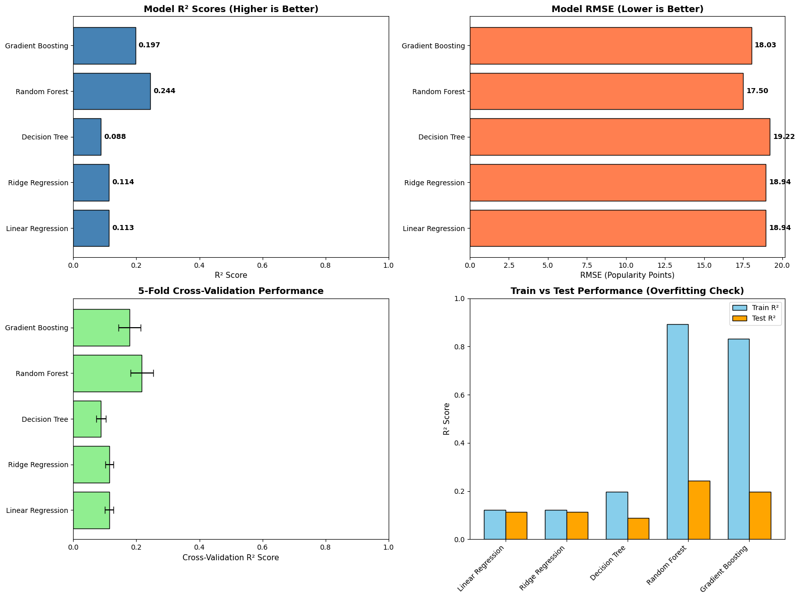

 # 🎵 Spotify Music Popularity Model

 A machine learning project used to research audio attributes in a spotify dataset that contribute the most to popularity.

 ## Overview

This project analyzes 4787 different songs from two datasets, high popularity songs, and low popularity songs. The goal is to identify which audio characteristics contribute most to a songs popularity score. These insights could help artists and record labels find out what features of song can give them an upper hand in trying to create a viral song.
## Research Questions

1. Which audio features are most correlated with popularity?
2. How much of a songs popularity can be explained by audio features?

## Dataset

### Source: [Kaggle Spotify Dataset](https://www.kaggle.com/datasets/solomonameh/spotify-music-dataset/data)

### Features:

- **Important audio features**: danceability, energy, loudness, speechiness, acousticness, instrumentalness, liveness, valence, tempo
- **Technical Attributes**: key, mode, time_signature, duration
- **Target Variable**: track_popularity(0-100 scale)

### Feature Description:

- **Energy**: A measure of intensity and activity. Typically, energetic tracks feel fast, loud, and noisy.
- **Tempo**: The speed of a track, measured in beats per minute (BPM).
- **Danceability**: A score describing how suitable a track is for dancing based on - tempo, rhythm stability, beat strength and overall regularity.
- **Loudness**: The overall loudness of a track in decibels (dB). Higher values indicate louder tracks overall.
- **Liveness**: The likelihood of a track being performed live. Higher values suggest more audience presence.
- **Valence**: The overall musical positiveness(emotion) of a track. High valence sounds happy; low valence sounds sad or angry.
- **Speechiness**: Measures the presence of spoken words.
- **Instrumentalness**: The likelihood a track contains no vocals. Values closer to 1.0 suggest solely instrumental tracks.
- **Mode**: Indicates the modality of the track.
- **Key**: The musical key, represented as an integer from 0 to 11, mapping to standard Pitch class notation.
- **Duration_ms**: The length of the track in milliseconds.
- **Acousticness**: A confidence measure of whether a track is acoustic(1) or not(0).

**Split track_popularity into four different ranges**: 

| Popularity Range | Count | Percentage |
|------------------|-------|------------|
| Low (0-40) | 1,180 | 25% |
| Medium (40-60) | 1,555 | 33% |
| High (60-80) | 1,691 | 36% |
| Very High (80-100) | 362 | 8% |

## Research

### Popularity Distribution:

### Feature Correlation:

### Relationships between variables and track popularity:

### Key Findings: 

### Finding 1:  Loudness shows the strongest positive relationship to song popularity
 - Loudness has the highest correlation coefficient (0.22) with popularity.
 - The scatter plot clearly shows that low-popularity songs cluster at lower loudness levels (-30 to -10 dB)
- High and Very High popularity songs concentrate at higher loudness levels (-10 to 0 dB)
### Finding 2: Acousticness Negatively Correlates with Popularity
- Low popularity songs heavily represented in high acousticness range (0.5-1.0)
- Very High popularity songs concentrate in low acousticness range (0.0-0.3)
- Correlation coefficient: -0.23 (moderate negative)
### Finding 3: Instrumentalness Strongly Negative
- Nearly all Very High popularity songs have instrumentalness near 0 (vocal-focused)
- Low popularity includes many instrumental tracks (0.5-1.0 range)
- Correlation coefficient: -0.26 (strongest negative correlation)
- Songs with more vocals are likely to be more popular
### Finding 4: Song Duration matters
 - Almost all very high popularity songs sit in the range between 2 and 6 minutes; anything above is populated with medium to low popularity songs.

## Machine Learning
### Models Used:
- Linear Regression: Baseline for linear relationships
- Ridge/Lasso Regression: Test regularization effects
- Decision Tree: Identify non-linear patterns
- Random Forest: Primary analytical tool for feature importance
- Gradient Boosting: Validate findings with alternative ensemble method

### Purpose: These models serve as research instruments to:

- Rank features by importance
- Quantify total explanatory power (R²)
- Detect feature interactions and non-linearities
- Validate on held-out test data

## Results
### Model Comparison Results
| Model | Train R² | Test R² | RMSE | MAE | CV Mean | CV Std |
|-------|----------|---------|------|-----|---------|--------|
| **Random Forest** ⭐ | 0.893 | **0.244** | **17.50** | **13.72** | 0.217 | 0.036 |
| Gradient Boosting | 0.833 | 0.197 | 18.03 | 14.00 | 0.178 | 0.035 |
| Decision Tree | 0.197 | 0.088 | 19.22 | 15.49 | 0.088 | 0.016 |
| Linear Regression | 0.122 | 0.113 | 18.94 | 15.43 | 0.114 | 0.013 |
| Ridge Regression | 0.122 | 0.114 | 18.94 | 15.44 | 0.114 | 0.013 |

| Model Type | R² Score | Interpretation |
|------------|----------|----------------|
| Linear Regression | 0.113 | Simple linear relationships explain only 11% |
| Random Forest | 0.244 | Non-linear patterns more than double explanatory power |
| Gradient Boosting | 0.197 | Confirms existence of complex interactions |

### Key Observations:

**1. Random Forest is the best analytical tool**
- Highest test R² (0.244) indicates best explanatory power
- Lowest prediction errors (RMSE: 17.5, MAE: 13.7)
- Selected for feature importance analysis

**2. Non-linear models outperform linear models by 2x**
- Linear/Ridge R² ≈ 0.11 (11% variance explained)
- Random Forest R² = 0.24 (24% variance explained)
- **Conclusion:** Relationships between audio features and popularity are non-linear

**3. Overfitting patterns reveal model complexity**
- **Random Forest:** Large gap (Train 0.89 → Test 0.24) but still best test performance
- **Gradient Boosting:** Similar overfitting pattern (Train 0.83 → Test 0.20)
- **Linear models:** Minimal overfitting (Train 0.12 → Test 0.11) but poor performance
- **Decision Tree:** Severe overfitting (Train 0.20 → Test 0.09) - too unstable

**4. Cross-validation confirms findings generalize**
- Random Forest CV: 0.217 ± 0.036 (close to test R² of 0.244)
- Results are consistent across different data splits
- Findings are robust, not due to lucky train/test split

**Feature Importance Based on Random Forest**: 

| Rank | Feature | Importance Score | Type | Insight |
|:----:|---------|:----------------:|------|---------|
| 1 | **instrumentalness** | 0.1064 | Original | Vocal presence is critical for popularity |
| 2 | **duration_min** | 0.0887 | Original | Song length matters  |
| 3 | **loudness** | 0.0802 | Original | Professional mastering impacts success |
| 4 | **loudness_energy** | 0.0764 | Engineered | Combination of strong indicators |
| 5 | **speechiness** | 0.0755 | Original | Amount of spoken words influences appeal |
| 6 | **tempo** | 0.0719 | Original | Song speed has measurable effect |
| 7 | **liveness** | 0.0674 | Original | Live vs. studio recording quality |
| 8 | **acousticness** | 0.0611 | Original | Electronic production preferred |
| 9 | **danceability** | 0.0553 | Original | Rhythm and groove contribute to appeal |
| 10 | **valence** | 0.0489 | Original | Musical positivity shows moderate effect |

## CONCLUSIONS

**Question 1 Answered**:

After finding the most important features from the random forest results it seems that **instrumentalness, duration, loudness, speechiness, and tempo** are most related to a songs popularity.

- **Instrumentalness** as the top predictor indicates that **vocal presence is critical** for mainstream popularity. Purely instrumental tracks face significant commercial challenges.

- **Duration** ranking second suggests listeners and algorithms favor songs within a specific length range, likely optimized for radio play and streaming engagement.

- **Loudness** in the top 3 confirms that professional audio production—particularly mastering quality—plays a measurable role in commercial success.

**Question 2 Answered**: 

Based on the R² value of 0.244 from the Random Forest model, approximately **24% of popularity variance can be explained by audio features alone**. 
While this may initially seem modest, it represents a meaningful and statistically significant relationship. The remaining 76% of variance is attributable to non-audio factors that fundamentally shape commercial success:
 
- **Artist brand recognition** - Established artists have built-in fan bases
- **Marketing investment** - Promotional budgets and strategies
- **Playlist placement** - Algorithmic and editorial curation on streaming platforms
- **Social media virality** - TikTok trends, viral moments, cultural timing
- **Cultural context** - Right song, right moment, right audience
- **Lyrics and vocals** - Semantic content not captured in instrumental features

## Insights for Musicians and Labels

- Optimize loudness - Professional mixing/mastering matters significantly
- Increase energy - High-energy tracks have measurably broader appeal
- Enhance danceability - Consider rhythm and groove in production
- Consider the combination - High energy + danceability + loudness creates synergy
- Don't over-rely on acoustics - Fully acoustic tracks face popularity challenges

##  Technologies Used

- Python 3.8+
- Data Analysis: pandas, numpy
- Statistical Modeling: scikit-learn
- Visualization: matplotlib, seaborn

